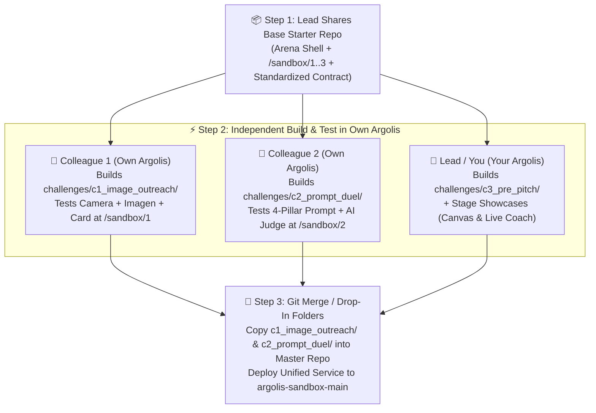
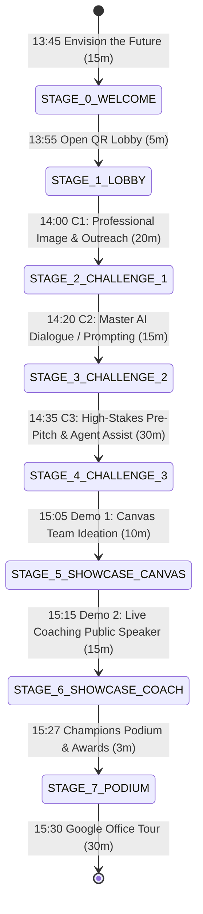
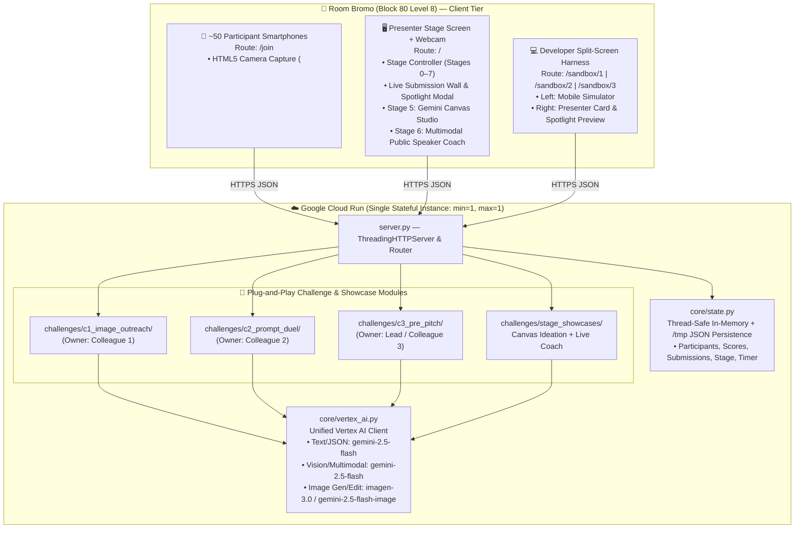

# PRD & SDD: Prudential (PAMB) Agency AI Bootcamp Arena
**Event:** Prudential Agency AI Bootcamp — Google Singapore (Room Bromo, Block 80 Level 8)  
**Date & Time:** 11 November 2026 | 12:45 PM – 4:00 PM (Core Arena Session: 1:45 PM – 3:30 PM)  
**Audience:** ~50–54 Prudential Assurance Malaysia Berhad (PAMB) Agency Leaders  
**Primary Languages:** Mandarin (`zh-CN` / `zh-TW`) & English (`en`), plus Bahasa (`ms`/`id`) support  
**Base Reference Implementation:** [server.py](file:///home/corpagent-eng-satishksingh/.gemini/jetski/brain/7af05b23-1afd-4c58-96cc-1de39f3b9bd0/scratch/agent-challenge-cloudrun/server.py) & [index.html](file:///home/corpagent-eng-satishksingh/.gemini/jetski/brain/7af05b23-1afd-4c58-96cc-1de39f3b9bd0/scratch/agent-challenge-cloudrun/static/index.html) (`the-10x-agent-challenge` on Cloud Run)

---

## Part 1: Collaboration Strategy — Should We Share Base Code First?

> [!IMPORTANT]
> **Yes — Share the Base Starter Repo BEFORE Your Two Colleagues Start Coding in Their Own Argolis Projects.**  
> Sharing a pre-scaffolded **Base Starter Kit** first is the single highest-leverage step to guarantee that all three challenges merge cleanly at the end in under 10 minutes with zero UI or API conflicts.

### 1.1 Why "Base Code First" Works Best Across Separate Argolis Environments
If three developers build from scratch in three separate Argolis projects, they will invent different JSON schemas, CSS styles, state structures, and Vertex AI auth wrappers. By sharing the **Base Arena Shell** first:
1. **Zero-Config Argolis Portability:** The base `vertex_ai.py` helper automatically detects the active GCP project (`os.environ.get("PROJECT_ID")` or `gcloud config get-value project`), so when Colleague A or Colleague B deploys to *their* Argolis Cloud Run, it works out of the box using their own Vertex AI quota.
2. **Strict Folder Isolation (Zero Git Conflicts):**
   * **Developer 1 (Challenge 1 — 14:00–14:20 Photo & Outreach):** Only touches `challenges/c1_image_outreach/`
   * **Developer 2 (Challenge 2 — 14:20–14:35 Prompt Craft Duel):** Only touches `challenges/c2_prompt_duel/`
   * **Developer 3 / Lead (Challenge 3 — 14:35–15:05 Pre-Pitch + Showcases 4 & 5):** Touches `challenges/c3_pre_pitch/` and `static/stage_showcases.js`
3. **Built-In Split-Screen Sandbox (`/sandbox/1`, `/sandbox/2`, `/sandbox/3`):** Each developer can test both the **Participant Phone Screen (Left)** and the **Presenter Big-Screen Submission & Score View (Right)** on one browser tab without needing a second person to run the Presenter Lobby.



---

## Part 2: Product Requirements Document (PRD)

### 2.1 Executive Summary & Vision
The **PAMB Agency AI Bootcamp Arena** is a dual-screen, multilingual interactive workshop platform built for ~50 Prudential Agency Leaders visiting Google Singapore on **11 November 2026**.

Instead of passive slides, every Agency Leader scans a QR code on the Room Bromo projector to join the live Arena from their smartphone (`/join`) in their preferred language (**Mandarin 简体/繁體** or **English**). Over a **105-minute interactive session (13:45 – 15:30)**, the Presenter guides the room through **3 Hands-On Mobile Challenges** (where participants take live photos, craft prompts, synthesize high-stakes pre-pitch proposals, submit their work, receive instant **AI Judge Scores**, and see their actual submissions showcased on the big screen) followed by **2 Live Stage Showcases** (**Team Ideation with Gemini Canvas** and **Live Multimodal Public Speaker Coaching**) and a **Champions Podium**.

### 2.2 Target Personas & User Roles
| Role | Device & Route | Key Needs |
| :--- | :--- | :--- |
| **Participant (PAMB Agency Leader)** | Smartphone (`https://<app>/join`) | • Frictionless 10-second onboarding (Name, Agency/Region, Language: `zh-CN`, `zh-TW`, `en`).<br>• Native mobile camera capture for headshots, tap-friendly prompt builders, and voice/text input.<br>• Instant AI feedback, clear scores (Speed + Quality/Strategy), and seeing their work celebrated on the main projector. |
| **Presenter / Stage Host & Coaches** | Room Bromo Projector (`https://<app>/`) | • One-click stage progression aligned 1:1 with the 11 Nov agenda (`LOBBY` → `C1` → `C2` → `C3` → `CANVAS` → `LIVE_COACH` → `PODIUM`).<br>• **"Live Submissions Wall" & Spotlight Modal** to display what participants actually submitted (AI photos, prompts, pre-pitch strategies) and their score breakdown.<br>• Built-in Stage Showcase views for **15:05 Canvas** and **15:15 Live Coaching** without switching apps. |
| **Challenge Developer (You + 2 Colleagues)** | Laptop + Phone (`https://<app>/sandbox/1..3`) | • Self-contained folder per challenge (`c1`, `c2`, `c3`) with a split-screen simulator to test mobile UI, Vertex AI calls, and Presenter submission cards independently. |

---

### 2.3 Minute-by-Minute Run-of-Show & User Journey (11 November)



| Time | Duration | Agenda Segment | Arena Stage | Participant Phone (`/join`) | Presenter Big Screen (`/`) |
| :--- | :--- | :--- | :--- | :--- | :--- |
| **12:45 – 13:00** | 15m | Arrival, Registration & Group Photo | *Pre-Session* | — | Digital Canvas Welcome at B70 L3 Reception |
| **13:00 – 13:45** | 45m | Welcome Luncheon | *Pre-Session* | — | Networking Lunch at Engagement Space (B80 L3) |
| **13:45 – 14:00** | 15m | **Envision the future** *(Overview of AI)* | `STAGE_0_WELCOME` → `STAGE_1_LOBBY` | Scan QR code → Enter Name, Region/Agency, Language (`简中`/`繁中`/`EN`) → Enter Briefing Room. | **13:45:** Executive AI Overview.<br>**13:55:** Giant QR Code + Live Joining Roster & Language Counter. |
| **14:00 – 14:20** | 20m | **Module 1: Reinvent your professional image & customer outreach**<br>*(The GenAI Magic: Taking your headshot and pictures to the AI era)* | `STAGE_2_CHALLENGE_1`<br>*(5m Demo + 15m Challenge)* | **1. Snap/Upload Photo:** Take live selfie via phone camera (or pick avatar).<br>**2. Style & Outreach:** Pick Executive Style (*MDRT Keynote, Forbes Studio, Festive VIP*) + Client Outreach Occasion + Personal Motto.<br>**3. Generate & Submit:** Generates AI Executive Portrait + Mandarin/EN VIP Outreach Card & submits to Arena. | **Live "PAMB Executive AI Gallery Wall":** Every submitted Before/After AI Portrait + VIP Outreach Card streams onto the big screen with an **AI Visual & Personalization Score (0–100)**. Presenter clicks 2–3 cards to open in **Full-Screen Spotlight**. |
| **14:20 – 14:35** | 15m | **Module 2: Master the art of AI dialogue**<br>*(Mastering prompting: How to get AI to do what you really want)* | `STAGE_3_CHALLENGE_2`<br>*(5m Demo + 10m Challenge)* | **1. Scenario:** Re-motivate a slumping agent OR convert a hesitant HNW business owner.<br>**2. Prompt Craft:** Write/refine prompt using the **4-Pillar Guide** (*Persona, Context, Task, Format/Tone*).<br>**3. Test & Submit:** Preview Gemini's response, iterate if needed, and submit for AI Judge grading. | **Live Prompt Duel Board:** Shows participant rankings + **"What They Prompted vs. What Gemini Produced"** cards. Clicking any submission reveals the **4-Pillar Radar Bar** (*Persona 25/25, Context 24/25, Task 23/25, Tone 24/25*) + AI Judge praise. |
| **14:35 – 15:05** | 30m | **Module 3: Drive faster pipeline, sharpen strategic proposal to sales close – Pre-pitch**<br>*(Using Gemini to synthesize info + Agent Assist as strategic partner)* | `STAGE_4_CHALLENGE_3`<br>*(10m Demo + 20m Challenge)* | **Step A (Gemini Synthesis):** Inspect HNW SME Owner Dossier + PAMB Policy Packet; run Gemini Grounded Synthesis to uncover the hidden protection/estate gap & exact policy clause.<br>**Step B (Agent Assist Sparring):** Client objects (*"My liquidity is tied up in factory expansion & FD"*). Use **Agent Assist** to co-create a killer pre-pitch counter-proposal and submit. | **Pre-Pitch War Room Dashboard:** Shows live **Agentic Pipeline Traces**, Speed + Strategic Depth scores, and **"View Strategic Proposal"** spotlights displaying the participant's synthesized pitch and verified policy citations. |
| **15:05 – 15:15** | 10m | **Module 4 (Demo Session 1): Canvas to ideate to your team**<br>*(Canvas to explore conceptual ideas into actual realisation)* | `STAGE_5_SHOWCASE_CANVAS`<br>*(10m Interactive Stage Demo)* | **Companion View:** Displays the live Canvas artifact being built on stage + **"📥 Save Team Blueprint to Phone"** button & **"💡 Suggest a Twist"** quick-poll buttons. | **Gemini Canvas Live Studio:** Presenter clicks **"Open Top Submission in Canvas"** (or picks an Agency Recruitment / Q1 MDRT Campaign idea). Split-screen shows **Prompt Evolution (Left)** transforming live into a **Formatted Agency Playbook + Interactive Visual Campaign Prototype (Right)**. |
| **15:15 – 15:30** | 15m | **Module 5 (Demo Session 2): Live coaching**<br>*(The Public Speaker: Using multimodal AI as your personal executive coach)* | `STAGE_6_SHOWCASE_COACH` → `STAGE_7_PODIUM`<br>*(12m Stage Hot-Seat + 3m Podium)* | **Audience Live Reaction & Coach Card:** Participants cheer on the stage speaker (`🔥`, `👏`, `💎`) and receive their personal **Full-Bootcamp 10x Executive AI Scorecard**. | **Multimodal Executive Coach Stage View:** 1–2 volunteer leaders step up to the Room Bromo camera/mic for a 60s live pitch. **Gemini Multimodal (Video Frames + Audio)** analyzes **Posture/Eye Contact, Vocal Pace/Conviction, and Empathy**, displaying a live **Executive Speaker Scorecard** + spoken Mandarin/EN coaching feedback, followed at **15:27** by the **Top 3 Champions Podium**! |
| **15:30 – 16:00** | 30m | Google Office Tour | *Post-Session* | Personal Summary & Takeaways downloadable on phone | Champion Banner & Tour Departure |

---

### 2.4 Functional Requirements by Module

#### Module 1 — Challenge 1: Reinvent Your Professional Image & Customer Outreach (14:00 – 14:20)
* **FR-C1.1 (Mobile Camera & Photo Upload):** Participant `/join` screen MUST support taking a live photo via smartphone camera (`<input type="file" accept="image/*" capture="user">` + inline WebRTC camera modal for desktop/tablet) OR selecting from 4 pre-loaded executive base portraits (for camera-shy participants).
* **FR-C1.2 (Client-Side Image Compression):** Before uploading over venue Wi-Fi, the browser MUST resize and compress the captured photo via HTML5 `<canvas>` to max `768×768px` JPEG (`quality: 0.82`, `<120 KB`) so upload + generation completes in `<4 seconds`.
* **FR-C1.3 (GenAI Transformation & VIP Outreach Card):** Participant selects:
  1. **Executive Style:** *Forbes Studio Executive*, *MDRT Gala Keynote Speaker*, *Warm Family Wealth Advisor*, or *Festive CNY / VIP Prosperity Portrait*.
  2. **Customer Outreach Occasion:** *Newborn Baby Protection Congratulations*, *SME Keyman / Legacy Milestone*, *Annual Policy & Wealth Portfolio Review*, or *Festive VIP Client Appreciation*.
  3. **Personal Hook / Signature Note** (in Mandarin or English).
* **FR-C1.4 (AI Output & Scoring):** Backend calls Vertex AI (`gemini-2.5-flash-image` / Imagen 3 edit/generation with stylized SVG/Canvas executive frame fallback if image API quota is throttled) + `gemini-2.5-flash` to craft a bilingual/Mandarin VIP outreach message. AI Judge scores **Visual Brand Alignment (35%)**, **Outreach Personalization (35%)**, and **Speed (30%)**.
* **FR-C1.5 (Presenter Gallery Wall):** Presenter screen displays a grid of **Submitted Executive Portraits + Outreach Cards** so the whole room can see the transformations live.

#### Module 2 — Challenge 2: Master the Art of AI Dialogue / Prompting (14:20 – 14:35)
* **FR-C2.1 (Contrastive "Bad Prompt vs. 10x Prompt" Experience):** Participant sees why a generic 5-word prompt (*"Write a message to a client"*) produces a robotic, useless reply.
* **FR-C2.2 (Guided 4-Pillar + Freeform Prompt Studio):** Participant selects 1 of 2 real PAMB leadership scenarios:
  * *Scenario A (Agency Leadership):* Re-ignite a talented 2nd-year agent whose pipeline stalled after 3 HNW rejections.
  * *Scenario B (Client Dialogue):* Persuade a 48-year-old business owner who says *"Insurance gives low returns compared to my factory and property investments."*
* **FR-C2.3 (Live AI Prompt Judge):** When the participant runs & submits their prompt, `gemini-2.5-flash` generates:
  1. The **AI Response** to their prompt (in Mandarin/English).
  2. A structured **4-Pillar Prompt Score (0–100)**: **Role/Persona (25 pts)**, **Context & Constraints (25 pts)**, **Task Clarity (25 pts)**, and **Format/Tone (25 pts)** + a 1-sentence **Coach Critique**.
* **FR-C2.4 (Presenter Prompt Spotlight):** Presenter screen displays each participant's **Submitted Prompt**, **Generated Output**, and **4-Pillar Score Bar** side by side.

#### Module 3 — Challenge 3: High-Stakes Pre-Pitch Synthesis & Agent Assist (14:35 – 15:05)
* **FR-C3.1 (Step 1 — Instant Multi-Doc Client Synthesis):** Participant is presented with a **High-Stakes Pre-Pitch Packet** (Client Profile: *Dato' Lim, 52, Manufacturing Owner, 2 children studying abroad, MYR 15M illiquid assets, legacy company debt* + *PAMB PRUWealth / Legacy Policy Rules*). Participant uses **Gemini Synthesis** to extract the top 3 financial vulnerabilities and exact policy clause citation (`Clause 4.2 — Business Succession & Estate Liquidity Trust`).
* **FR-C3.2 (Step 2 — Agent Assist Strategic Sparring):** An interactive **Agent Assist Co-Pilot** simulates Dato' Lim's pre-pitch objection. The participant selects a strategic angle and co-authors a tailored **Pre-Pitch Executive Proposal & Objection Counter** with Agent Assist.
* **FR-C3.3 (Scoring & Trace):** Displays the **4-Step Agentic Pipeline Trace** (*Client Risk Profiler → Policy Clause RAG Retriever → Agent Assist Objection Strategist → Proposal Synthesizer*) and scores **Synthesis Accuracy (35%)**, **Strategic Persuasion (40%)**, and **Speed (25%)**.

#### Module 4 — Demo Session 1: Canvas to Ideate to Your Team (15:05 – 15:15)
* **FR-S1.1 (Presenter "Send to Canvas" Integration):** Presenter can either click **"🎨 Open in Canvas"** on any top submission from Challenge 2/3 OR pick from 3 pre-wired PAMB Executive Ideation Seeds (*1. "90-Day MDRT Sprint & Rookie Mentorship System"*, *2. "PAMB High-Net-Worth Legacy Family Office Seminar Concept"*, *3. "Gen-Z Financial Planner Recruitment Campaign"*).
* **FR-S1.2 (Split-Screen Live Realization):**
  * **Left Panel (Ideation & Refinement Chat):** Presenter clicks quick-iteration chips (e.g., *"Add a 4-week KPI table in Mandarin"*, *"Transform into an interactive visual recruitment landing page"*, *"Add objection-handling roleplay script for team morning huddles"*).
  * **Right Panel (Live Canvas Artifact):** Renders both a **Rich Executive Document View** and a **Live Interactive Visual Preview** side by side, updating in real time via `gemini-2.5-flash`.
* **FR-S1.3 (Audience Phone Sync):** Participant phones automatically switch to **Canvas Companion Mode**, allowing leaders to vote on the next refinement and save the generated Canvas blueprint to their phone.

#### Module 5 — Demo Session 2: Live Coaching — The Public Speaker (15:15 – 15:30)
* **FR-S2.1 (Multimodal Stage Hot-Seat UI):** Presenter screen opens a dedicated **Multimodal Executive Coach Studio** with:
  * **Live Webcam Viewport (`navigator.mediaDevices.getUserMedia({ video: true, audio: true })`)** showing the volunteer speaker on stage in Room Bromo.
  * **Live Speech-to-Text & Audio Energy Waveform** (`webkitSpeechRecognition` supporting `zh-CN`, `zh-TW`, `en-US` + manual/sample fallback so it is 100% bulletproof even if mic permissions or Wi-Fi hiccup).
* **FR-S2.2 (Multimodal Vision + Voice Analysis):** During a 45–60 second live pitch, the app captures 3 keyframes from the camera feed (`<canvas>` snapshots) + the spoken transcript and sends a single multimodal request to `gemini-2.5-flash` (vision + text/audio metrics) to evaluate:
  * **Executive Presence & Body Language (0–100):** Eye contact, posture, confidence, facial warmth.
  * **Vocal Delivery & Pacing (0–100):** Clarity, energy, pacing, conviction.
  * **Persuasive Impact & Structure (0–100):** Opening hook, empathy, call to action.
* **FR-S2.3 (Spoken AI Coach Feedback + Crowd Reactions):** The AI Executive Coach displays a visual scorecard and **speaks aloud** its coaching feedback in Mandarin or English (`window.speechSynthesis` / TTS), while the 50 participants tap live reaction buttons (`🔥`, `👏`, `💎`) on their phones that float up the projector screen!

---

## Part 3: Software Design Document (SDD)

### 3.1 System Architecture & Component Topology



### 3.2 Directory & File Structure (Designed for 3-Way Parallel Development)

```text
pamb-ai-arena/
├── Dockerfile                      # Python 3.11-slim, exposes PORT=8090
├── requirements.txt                # requests, google-auth
├── server.py                       # HTTP server, core routes (/api/state, /api/register, /api/submit, /api/game-control)
├── core/
│   ├── __init__.py
│   ├── state.py                    # Thread-safe state manager, score aggregation, submission storage
│   └── vertex_ai.py                # Shared Vertex AI wrapper (text, structured JSON, multimodal vision, image gen + fallbacks)
├── challenges/
│   ├── c1_image_outreach/          # 👤 COLLEAGUE 1 OWNS THIS FOLDER ONLY
│   │   ├── backend.py              # handle_c1_ai(body, vertex_client) -> dict
│   │   └── frontend.js             # Registers window.ArenaModules.c1 = { MobileView, SubmissionCard, SpotlightView }
│   ├── c2_prompt_duel/             # 👤 COLLEAGUE 2 OWNS THIS FOLDER ONLY
│   │   ├── backend.py              # handle_c2_ai(body, vertex_client) -> dict
│   │   └── frontend.js             # Registers window.ArenaModules.c2 = { MobileView, SubmissionCard, SpotlightView }
│   ├── c3_pre_pitch/               # 👤 COLLEAGUE 3 / LEAD OWNS THIS FOLDER ONLY
│   │   ├── backend.py              # handle_c3_ai(body, vertex_client) -> dict
│   │   └── frontend.js             # Registers window.ArenaModules.c3 = { MobileView, SubmissionCard, SpotlightView }
│   └── stage_showcases/            # 🎬 DEMO SESSIONS 4 & 5 (15:05 Canvas + 15:15 Live Coach)
│       ├── backend.py              # handle_canvas_ai() & handle_coach_multimodal_ai()
│       └── frontend.js             # Registers window.ArenaModules.showcases = { CanvasStageView, LiveCoachStageView }
└── static/
    └── index.html                  # Core Presenter Shell, /join Shell, /sandbox/1..3 Harness, loads challenges/*/frontend.js
```

---

### 3.3 Data Models & API Contracts (The Plug-and-Play Interface)

#### A. Arena Stage Enum (`phase`)
The Presenter controls the active room stage via `POST /api/game-control`:
* `LAUNCH` — Initial Welcome Keynotes (13:45 – 13:55)
* `LOBBY` — Giant QR Code + Live Participant & Language Roster (13:55 – 14:00)
* `CHALLENGE_1` — Professional Image & VIP Customer Outreach (14:00 – 14:20)
* `CHALLENGE_2` — Master the Art of AI Dialogue / Prompt Duel (14:20 – 14:35)
* `CHALLENGE_3` — Pre-Pitch Synthesis & Agent Assist War Room (14:35 – 15:05)
* `SHOWCASE_CANVAS` — Demo 1: Canvas to Ideate to Your Team (15:05 – 15:15)
* `SHOWCASE_COACH` — Demo 2: Live Coaching — The Public Speaker (15:15 – 15:27)
* `PODIUM` — Final Leaderboard Podium & 10x Executive Takeaways (15:27 – 15:30)
* *(Note: Presenter also has an **"All Challenges Open (Free Play)"** toggle in case they want all 3 challenges unlocked simultaneously).*

#### B. Standardized Submission & Score Contract (`POST /api/submit`)
Every challenge module (`c1`, `c2`, `c3`) calls `submitMission(payload)` on the frontend, which posts to `POST /api/submit`. By standardizing `submission` and `scores`, the Presenter screen automatically renders the **Live Submissions Wall**, **Participant Battle Cards**, and **Full-Screen Spotlight Modal**:

```json
{
  "id": "agent-1730139000123",
  "name": "Dato' Michael Tan",
  "country": "Malaysia",
  "language": "zh-CN",
  "challenge": "1",
  "timeSec": 45,
  "speed": 92,
  "accuracy": 96,
  "criteriaScores": {
    "Executive Brand": 97,
    "Client Personalization": 95,
    "Speed": 92
  },
  "judgeFeedback": "极具MDRT总监风范！结合新生儿贺词与教育金规划，既有温度又具专业度。",
  "submission": {
    "type": "image_outreach",
    "headline": "MDRT Executive Portrait • Newborn VIP Greeting",
    "userInput": "Style: MDRT Keynote | Occasion: Newborn Baby | Motto: 守护每个家庭的未来",
    "aiOutput": "陈先生您好！衷心祝贺您喜添千金！作为您的家庭财务顾问，我为您准备了一份专属的宝宝教育金与家庭保障蓝图...",
    "imageBefore": "data:image/jpeg;base64,...",
    "imageAfter": "data:image/jpeg;base64,...",
    "tags": ["📸 AI Studio Portrait", "🍼 Newborn VIP Hook", "🇲🇾 Mandarin"]
  }
}
```

#### C. Isolated Challenge AI Endpoint (`POST /api/challenge/<1|2|3>/ai`)
Each colleague's backend module (`challenges/c<N>_.../backend.py`) exposes a single pure Python function:
```python
def handle_challenge_ai(body: dict, vertex: VertexClient) -> dict:
    """
    Receives the JSON body from POST /api/challenge/<N>/ai
    Calls vertex.generate_text(), vertex.generate_json(), or vertex.generate_image()
    Returns a dict that is sent directly back to the participant's phone.
    """
```
This guarantees that:
* **Colleague 1** can pass `{"photoBase64": "...", "style": "mdrt_studio", "occasion": "newborn", "language": "zh-CN"}` to `/api/challenge/1/ai`.
* **Colleague 2** can pass `{"scenarioId": "hnw_objection", "userPrompt": "...", "language": "zh-CN"}` to `/api/challenge/2/ai`.
* **Colleague 3** can pass `{"step": "synthesize" | "agent_assist", "userStrategy": "...", "language": "zh-CN"}` to `/api/challenge/3/ai`.

---

### 3.4 Operational Guardrails & Failure Mode Mitigation (Room Bromo Readiness)

| Risk / Failure Mode in Live Workshop | Engineering Mitigation Built Into Base Architecture |
| :--- | :--- |
| **50 Participants Upload 5MB Phone Photos Simultaneously** (Wi-Fi / Memory spike) | Client-side HTML5 `<canvas>` downscales all camera photos to `512×512px` JPEG (`quality: 0.80`, ~45 KB) before `POST`, keeping total memory for 50 photos under `5 MB`. |
| **Vertex AI Rate Limit (`429 Quota Exceeded`) when 50 Leaders Click "Generate" at Once** | `core/vertex_ai.py` implements automatic model cascade (`gemini-2.5-flash` → `gemini-2.5-flash-lite` → `gemini-2.0-flash`) + high-quality **Bilingual Instant Fallback Responses** (`zh-CN`, `zh-TW`, `en`) so no participant *ever* sees an error screen during the live event. |
| **Cloud Run Multi-Instance Split-Brain** (Participants land on different containers and don't appear on Presenter screen) | Deploy command strictly enforces `--min-instances=1 --max-instances=1 --concurrency=80` so all 50 participants and the Presenter share the exact same in-memory + `/tmp` state lock with `<15ms` read latency. |
| **Room Bromo Stage Mic / Camera Permission Blocked During 15:15 Live Coaching** | `Stage 6: Live Coach` includes both **Live WebRTC Camera + Mic Capture** AND a **1-Click "Simulate Live Pitch / Manual Transcript" Backup Button**, ensuring the stage demo succeeds even if the presentation laptop blocks browser mic permissions. |

---

## Part 4: Next Steps — Ready to Execute

1. **Review & Approve this PRD/SDD:** Let me know if you want any tweaks to the 3 challenges, the 2 stage showcases, or the scoring criteria.
2. **Generate the Base Starter Repo (`pamb-ai-arena`):** Once you approve, I can immediately scaffold the modular `pamb-ai-arena` codebase (ported from your Tokyo app with the new 11 Nov PAMB stages, `/sandbox/1..3` developer harness, camera upload, Live Submissions Wall, Canvas Showcase, and Multimodal Live Coach) so you can test it and share the base repo with your two colleagues!
3. **Sync to Your Google Doc (Optional):** I can also update [Agenda - PAMB Agency Leaders' Visit](https://docs.google.com/document/d/1BAusmK3rtNWz1CZBeoodrQPp0pGzKWh-dL52jkuw0v8/edit?tab=t.0) with this finalized 11 Nov run-of-show table.
